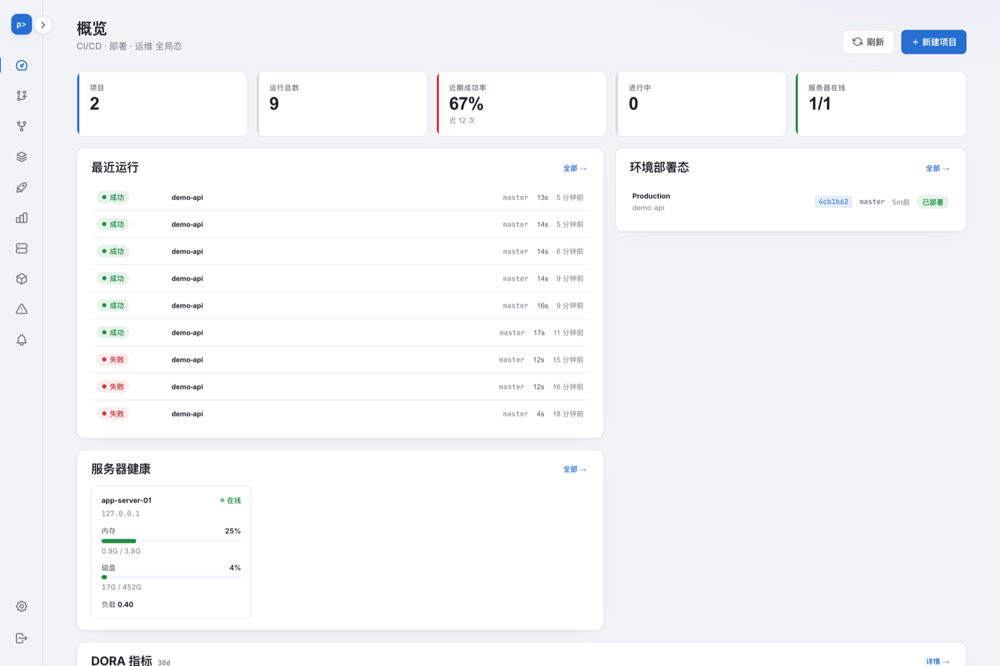
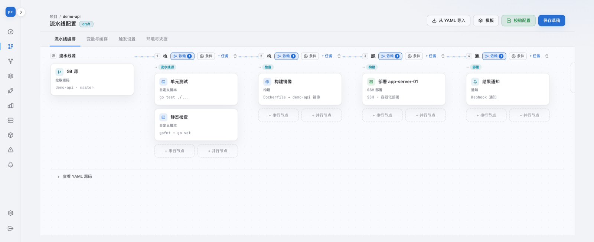
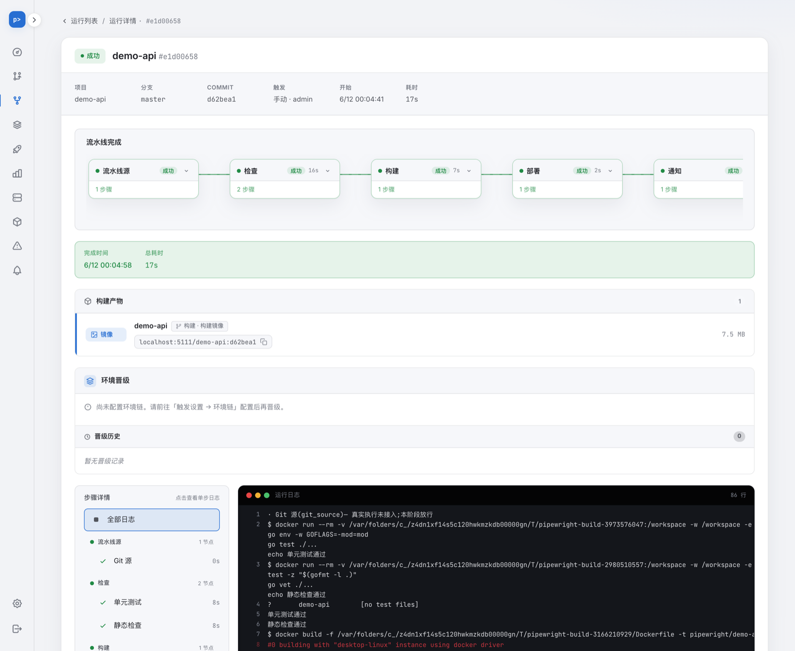
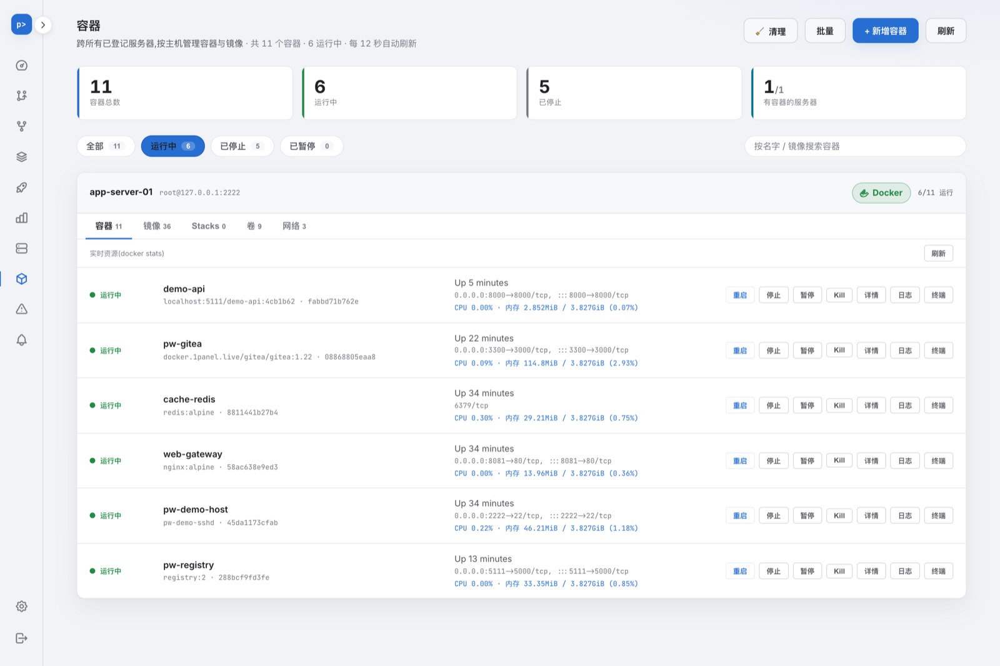

<div align="center">

# Pipewright

**A lightweight, self-hosted CI/CD + deployment + ops platform.**
A single static Go binary (frontend embedded, zero runtime dependencies) —
one tool replacing the "CI + Ansible/Kamal + Portainer" trio.

[](https://github.com/huangchengsir/pipewright/releases)
[](https://github.com/huangchengsir/pipewright/actions/workflows/ci.yml)
[](LICENSE)

English | [简体中文](README.zh-CN.md)

</div>

---

## Why Pipewright

Mainstream options are either heavy (Jenkins with a pile of plugins + JVM) or a three-tool assembly (Woodpecker/Drone + Ansible/Kamal + Portainer). Pipewright packs "continuous integration, multi-server deployment, and server/container ops" into **one static binary**: download, start, open the browser — that's the entire install.

It has since grown past that trio: publishing a deployed service on an HTTPS domain (the nginx + certbot step) and giving every pull request its own live preview URL are built in too.

| | Pipewright | Jenkins | Drone + Ansible + Portainer |
|---|:---:|:---:|:---:|
| Single-binary deploy | ✅ | ❌ JVM + plugins | ❌ three-tool assembly |
| Visual pipeline orchestration (DAG) | ✅ built-in canvas | plugin | hand-written YAML |
| Pipeline as code (per-branch YAML) | ✅ | plugin | ✅ |
| Isolated builds | ✅ | ✅ | ✅ |
| Multi-server deploy (SSH, agentless) | ✅ built-in | plugin | Ansible |
| Server / container ops | ✅ built-in | ❌ | Portainer |
| Zero-downtime + failure rollback | ✅ | plugin | DIY |
| Auto HTTPS + domain reverse proxy | ✅ built-in | ❌ | ❌ |
| Per-PR preview environments | ✅ built-in | ❌ | ❌ |
| DORA metrics | ✅ built-in | plugin | ❌ |
| AI failure diagnosis | ✅ optional | ❌ | ❌ |
| One-click self-update | ✅ | ❌ | ❌ |

## Screenshots

**Global overview** — projects, run success rate, environment deployment status, server health, and DORA metrics, all on one screen:



**Visual pipeline orchestration** — a two-level (stage/job) DAG canvas: horizontal links for serial, vertical side-by-side for true parallel. Supports matrix builds, manual approval gates, sidecar services, and post-stage steps; the canvas and YAML round-trip both ways:



**Run detail** — stage transitions, live logs (SSE push + history replay), build artifacts and image references, and per-step status:



**Container management** — one-stop management of containers/images/Stacks/volumes/networks across hosts, with lifecycle operations, live stats, logs, and an interactive terminal:



## Feature Overview

- **🔐 Security foundation** — single-admin auth (argon2id + CSRF) · encrypted credential vault (NaCl secretbox, masked display, never plaintext) · OAuth app onboarding for Gitee / GitHub / GitLab / self-hosted instances (the access token lands straight in the vault as a reusable credential) · append-only audit (SQLite triggers hard-block UPDATE/DELETE) with an optional remote sink · per-run secret redaction across logs, diagnostics, and notifications.
- **🧩 Projects & pipelines** — visual orchestration canvas (stage DAG + intra-stage job-level DAG) · matrix builds · manual approval gates (approve straight from a notification via signed link) · sidecar services (attach DB/Redis for tests) · stage `when` conditions + post-stage steps · typed run parameters (enum/bool/number, validated at trigger time) · triggers: webhook, branch→environment mapping, 5-field cron, and upstream→downstream pipeline chaining (loop-safe by depth + path guards) · per-project concurrency caps with FIFO queueing · a reuse library of pipeline templates, variable groups, and custom nodes · server-authoritative validation.
- **📝 Pipeline as code** — commit the pipeline structure to `.pipewright.yml` and let it evolve per branch, with the canvas as the always-available fallback ([details below](#pipeline-as-code-gitops)).
- **🏗 Isolated builds & artifacts** — version-pinned isolated builds inside containers (docker/nerdctl/podman) · a local bare-mirror repo cache (incremental fetch, then a workspace in seconds) · build dependency caching keyed by branch + lockfile hash · a content-addressed artifact store that keeps the **real bytes** of jar/dist for deployment (not just a placeholder reference) · image build + push to private registries with image GC · an optional remote build machine per project (build is offloaded over SSH; tokens stay on the control node) · JUnit + Cobertura test reports feeding quality gates that fail the stage and block downstream deploys · live terminal logs (SSE) + history replay · read-only code browsing (Monaco).
- **🚀 Multi-server deployment** — agentless deploy over SSH · health gating · zero-downtime cutover + failure rollback · parallel fan-out across hosts + visible partial failures · command-style deploys (restart a service with no artifact) · **environments as first-class objects**: per-environment deployment timeline, current active version, and one-click rollback to the last fully successful deploy · environment promotion chains (dev→staging→prod) with per-environment variables/secrets and approval gates.
- **🌐 Auto HTTPS + domain reverse proxy** — one managed Caddy container per target host, orchestrated over the same SSH + docker path as container ops (render Caddyfile → `docker cp` → graceful reload). Certificates are issued and renewed automatically by Let's Encrypt over HTTP-01, or over **DNS-01 with Cloudflare / DNSPod / Alibaba Cloud DNS** for wildcards. Plus: multi-domain aliases, path routing (`/api`→A, `/`→B), redirects, access control (basic auth, IP allow/deny CIDR), HSTS / security headers / compression, load balancing across upstreams with active health-check failover, WebSocket / gRPC (h2c) / TCP passthrough (caddy-l4), a certificate dashboard that probes the real 443 handshake, and one-click subdomain allocation.
- **🔎 Per-PR preview environments** — when a PR's run deploys successfully, it automatically gets a throwaway `pr-<n>-<proj>.<base>` domain with its own certificate and route, so reviewers open one link and see that PR actually running. Idempotent per PR, and reclaimed automatically — but **only** once the PR is provably closed or merged.
- **📣 Notifications** — WeCom / DingTalk / Lark (Feishu) / Slack / email / custom webhook · fine-grained event→channel routing · templates + custom variables · rich Lark cards with approve/detail action buttons and a release summary · in-pipeline notification nodes.
- **🖥 Server & container ops** — multi-host status overview (CPU/memory/disk) plus time-series trend charts · container/image/Stacks/volume/network management · container create/inspect/prune · live + historical service logs · live stats · interactive container terminal · web ops terminal (host shell, full copy-paste/signal support) · configurable anomaly detection that runs on a timer, dedupes by cooldown, and routes alerts to your notification channels.
- **🤖 AI assist (optional, fully degradable)** — bring your own Claude / OpenAI / Ollama endpoint (API key encrypted in the vault). Automatic root-cause diagnosis when a build or deploy fails, with a 👍/👎 feedback loop and accuracy stats · repo analysis → generated pipeline draft · success-vs-failure commit diff · script risk annotation · natural-language→shell assistant and container diagnosis in the ops terminal. The core CI/CD path never depends on any of it (NFR-10).
- **📈 Metrics** — the four DORA metrics (deployment frequency / lead time for changes / change failure rate / mean time to restore) out of the box, with Elite/High/Medium/Low performance bands.
- **🧹 Housekeeping & platform** — configurable run-data retention sweeper (off by default; never touches in-flight runs) · SQLite (pure Go) or MySQL · 8 UI languages (zh-CN / zh-TW / en / ja / ko / de / fr / es) including server-side localization of API error messages.
- **🔄 Update check + one-click self-update** — Settings → System checks the explicitly selected GitHub or configured Gitee source for the latest release with semantic comparison; binary deployments can **auto-update with one click** from the UI (download + checksum verification + atomic replace + self-restart), while Docker deployments get the exact upgrade command.

> Security is non-negotiable: credentials stored as ciphertext only, commands arrayified against injection, outbound SSRF locked down, logs redacted.

## Install / Deploy

Pick any of three form factors. The platform itself is a single static binary with **zero runtime dependencies** (no Go/Node required).

> **Docker prerequisite**: the platform itself doesn't depend on Docker, but **"isolated builds / container deployment" do require Docker** (without it, it degrades to a stub runner and performs no real builds). The console / SSH deployment / notifications don't need Docker. The one-click script **detects Docker** and prompts if it's missing; on Linux you can set `INSTALL_DOCKER=1` to auto-install it (via the official get.docker.com); on macOS, install Docker Desktop.

### ① One-click script (Linux / macOS)

Downloads the static binary for your platform from GitHub Releases by default and installs it to `/usr/local/bin` (with checksum verification + Docker detection). `SOURCE=gitee` explicitly selects a configured official Gitee mirror; sources are never switched silently:

```bash
curl -fsSL https://raw.githubusercontent.com/huangchengsir/pipewright/master/install.sh | sh

# Pin a version / custom dir / auto-install Docker on Linux too:
VERSION=v1.0.0 INSTALL_DIR=$HOME/.local/bin INSTALL_DOCKER=1 \
  sh -c "$(curl -fsSL https://raw.githubusercontent.com/huangchengsir/pipewright/master/install.sh)"

# Run (first launch bootstraps the admin; master key is for the credential vault)
PIPEWRIGHT_MASTER_KEY=$(openssl rand -base64 32) \
PIPEWRIGHT_ADMIN_PASSWORD=change-me \
  pipewright          # open http://localhost:8080, log in with admin / change-me
```

**Recommended: install as a systemd service** (auto-start on boot + restart on crash + one-click self-update available; Linux, requires root). The script persists the master key to `/etc/pipewright/master.key`, stores data in `/var/lib/pipewright`, and writes config to `/etc/pipewright/pipewright.env`:

```bash
SETUP_SERVICE=1 sh -c "$(curl -fsSL https://raw.githubusercontent.com/huangchengsir/pipewright/master/install.sh)"
# Status / logs: systemctl status pipewright  ·  journalctl -u pipewright -f
# Change port etc.: edit /etc/pipewright/pipewright.env then systemctl restart pipewright

# Use MySQL instead of the default SQLite (DSN is go-sql-driver format; parseTime=true is required):
SETUP_SERVICE=1 PIPEWRIGHT_DB_DRIVER=mysql \
  PIPEWRIGHT_DB_DSN='user:pw@tcp(host:3306)/pipewright?parseTime=true&charset=utf8mb4' \
  sh -c "$(curl -fsSL https://raw.githubusercontent.com/huangchengsir/pipewright/master/install.sh)"
```

**Gitee binary source (opt-in):** obtain the same `install.sh` from the project's trusted source or a verified code mirror. Gitee installation additionally requires Python 3.9+ for strict release/JSON validation; GitHub installation keeps its original dependencies.

```sh
# Set this to the public mirror prepared by the Pipewright maintainer.
# Do not substitute an arbitrary third-party download URL.
SOURCE=gitee PIPEWRIGHT_GITEE_RELEASE_REPO=owner/pipewright VERSION=vX.Y.Z \
  sh ./install.sh
```

A Gitee release is installable only after all six original platform archives,
`checksums.txt`, and the final `pipewright-release.json` completion marker have
been published consistently. An unavailable or partially synchronized mirror
fails safely without changing the installed program. The installer does not
create a mirror, obtain credentials, query geography, or fall back across sources.
For a newly created systemd service, the configured mirror repository and initial
Gitee source choice are written to the environment file; an existing environment file is preserved.

> Windows users: download the `.zip` from [Releases](https://github.com/huangchengsir/pipewright/releases).

### ② docker compose (recommended for self-hosting)

When running a Docker-CLI-enabled Pipewright container with the host Docker socket,
toolchain jobs copy their source workspace into a per-job Docker volume and recover
build outputs afterward. No shared host `/tmp` mount is needed. Native binary builds
keep direct workspace mounts. The standard distroless image still requires a
Docker CLI-enabled image or a native installation for local builds; mounting the
Docker socket grants host-level control and should only be done in a trusted setup.

```bash
curl -fsSLO https://raw.githubusercontent.com/huangchengsir/pipewright/master/docker-compose.yml
curl -fsSLO https://raw.githubusercontent.com/huangchengsir/pipewright/master/.env.example
cp .env.example .env       # at minimum set PIPEWRIGHT_ADMIN_PASSWORD, and openssl rand -base64 32 for MASTER_KEY
docker compose up -d       # data persists in the named volume pipewright-data; see .env comments to switch to MySQL
```

### ③ docker run (fastest trial)

```bash
docker run -d -p 8080:8080 -v pipewright-data:/data \
  -e PIPEWRIGHT_ADMIN_PASSWORD=change-me \
  -e PIPEWRIGHT_MASTER_KEY=$(openssl rand -base64 32) \
  ghcr.io/huangchengsir/pipewright:latest
```

### Build from source

```bash
make build          # frontend build → go:embed → single static binary ./pipewright (pure Go, no CGO)
./pipewright --version
```

### Updating

Open **Settings → System**, choose the release source, and click "Check for updates".
GitHub remains the default. Gitee is available only when the instance operator
sets `PIPEWRIGHT_GITEE_RELEASE_REPO=owner/repository` to the maintainer's public
mirror; changing a source does not make an incomplete mirror usable. A saved
source choice applies to new checks and tasks. Gitee checks completely paginate the
release list and select the highest stable semantic version, so backfilling an old
release cannot downgrade the offered version. An incomplete page scan or incomplete
highest stable release fails instead of silently selecting an older version.
An interrupted task stays bound
to its original source, repository, version and SHA256, including after restart.
When a new version is available:

- **Binary deployment**: click "Update now" to auto-download the new version + verify checksum + replace + restart (requires write permission to the binary file; installing to `$HOME/.local/bin` avoids sudo, and a root systemd service installed via `SETUP_SERVICE=1` also satisfies this).
- **Docker deployment**: the container doesn't replace its own image; follow the prompt to run `docker compose pull && docker compose up -d` on the host (the data volume is preserved).

### Maintaining the official Gitee release mirror

This is an optional maintainer workflow, not a requirement for GitHub installs:

1. Prepare a public Gitee repository. The sync script copies only the selected
   already-published GitHub tag and its reachable Git objects into a temporary bare
   repository, verifies the full commit, and pushes that single missing tag without
   force. Existing tags must resolve to the same commit; branches are never changed.
   Initial empty/private repository setup and publication are a separate operator step.
2. Set the GitHub repository variable `GITEE_RELEASE_REPO` to its `owner/repo`
   and the repository secret `GITEE_RELEASE_TOKEN` with permission to push tags,
   manage its Releases/attachments, and read the token account's profile (`user_info`)
   to obtain the correct HTTPS Git username. Never put the token in the product settings, a URL,
   source files, logs, or a support conversation.
3. After the normal `release` workflow succeeds, `gitee-release-mirror` copies
   the exact original stable Release assets. It can also be explicitly dispatched
   for an existing `vX.Y.Z` tag. Mirror jobs are serialized with up to 100 pending
   runs (`queue: max`), retaining earlier pending releases within that bound.
   No packages are rebuilt or new source versions
   created; the exact selected published Git tag is copied only when missing.
   No repositories/branches are created, and Docker/GHCR images are not mirrored.
4. Synchronization verifies the original GitHub asset digests, stages a Gitee
   prerelease, anonymously reads back all six packages and the original checksum
   file, uploads the completion marker last, then publishes the stable mirror.
   The script never overwrites mismatching remote files or an incomplete already
   published mirror. Git credentials exist only in a scoped in-memory HTTP header
   of the push subprocess; URL/argv, credential helpers and Git trace logs contain
   no token. Git and Python 3.9+ must be available (both are included on the workflow
   runner). After an uncertain push or upload, inspect the remote state and explicitly
   rerun the same tag; the script reads identities first and reuses matching content.
5. Verify the completed public mirror before configuring users' instances.
   Plan account capacity and a documented version-retention policy separately;
   this workflow never deletes old Releases or attachments automatically.

A completion marker and checksums provide release completeness and byte-integrity
checks under the selected source's trust. They are not independent cryptographic
signatures or cross-source authentication. Gitee may restart a download from zero
when its CDN does not supply a usable ETag or honor Range requests.

### Kubernetes deployment

Deploy an explicitly selected pushed image digest to one container of an existing Deployment through local Linux Docker or a pinned SSH executor. Protected credentials, exact target permissions, approval, rollout checks and read-only reconciliation are built in. Kubernetes jobs use a dedicated deployment stage; they do not execute arbitrary kubectl/Helm or use SSH rollback. See the [setup and operational guide](docs/kubernetes-deploy.md).

### Configuration (environment variables)

A normal install only needs the first two (plus `PIPEWRIGHT_PUBLIC_URL` if you run behind a reverse proxy); everything else has a sane default.

**Core**

| Variable | Description | Default |
|---|---|---|
| `PIPEWRIGHT_ADMIN_PASSWORD` | Admin password on first launch | none (must be set) |
| `PIPEWRIGHT_MASTER_KEY` | Credential vault master key (base64-encoded 32 bytes); or use `PIPEWRIGHT_MASTER_KEY_FILE` to point to a file | vault disabled if unset |
| `PIPEWRIGHT_ADDR` | HTTP listen address | `:8080` |
| `PIPEWRIGHT_DATA_DIR` | Persistent process-identity directory for Kubernetes restart recovery; keep it stable across restarts | `.pipewright` |
| `PIPEWRIGHT_PUBLIC_URL` | Externally reachable base URL (e.g. `https://ci.example.com`). Required for webhook callbacks, OAuth redirects, signed approval links in notifications, and PR status links | none |
| `PIPEWRIGHT_ADMIN_USERNAME` | Admin username on first launch | `admin` |
| `PIPEWRIGHT_TRUST_PROXY` | Trust the first `X-Forwarded-For` hop as the audit client IP (`1`/`true`/`yes`/`on`). Leave off unless a trusted reverse proxy sits in front — otherwise anyone can forge audit source IPs | off |
| `PIPEWRIGHT_RELEASE_REPO` | GitHub repo queried for update checks (change it for a fork) | `huangchengsir/pipewright` |
| `PIPEWRIGHT_GITEE_RELEASE_REPO` | Explicit public Gitee release mirror (`owner/repository`); enables the Gitee source | unavailable when unset |
| `PIPEWRIGHT_UPDATE_SOURCE` | Initial release source (`github` or `gitee`); applies only before an administrator saves a source preference; Gitee also requires its repository | `github` |
| `PIPEWRIGHT_RUNTIME` | Set `docker` to declare a container deployment (affects self-update mode); otherwise auto-detected via `/.dockerenv` | auto-detect |
| `PIPEWRIGHT_AUDIT_SINK` | Remote audit sink: an `http(s)://` endpoint, or any other value as a second local JSON Lines file path. Keeps audit records complete even if the local DB is wiped | none |

### Git SSH repositories

For Git SSH repositories, use `git@host:group/repo.git` on port 22 or
`ssh://git@host:2424/group/repo.git` for a custom port. Select an SSH key or
SSH password credential in the project form. Before connecting, verify the
server's SSH host key out of band and add it to the Pipewright process
account's `~/.ssh/known_hosts`; alternatively set `SSH_KNOWN_HOSTS` to a
known-hosts file. Unknown or changed host keys are rejected. SSH private keys
are stored only in the encrypted credential vault.

**Database**

| Variable | Description | Default |
|---|---|---|
| `PIPEWRIGHT_DB_DRIVER` | Database driver: `sqlite` or `mysql` | `sqlite` |
| `PIPEWRIGHT_DB` | SQLite database path (when driver=sqlite) | `pipewright.db` |
| `PIPEWRIGHT_DB_DSN` | MySQL DSN (required when driver=mysql) | none |

**Runs & builds**

| Variable | Description | Default |
|---|---|---|
| `PIPEWRIGHT_RUNNER` | Run executor: default DAG (orchestrates stages/script/deploy_ssh/notify per the canvas); set `legacy` to fall back to the old fixed flow | `dag` |
| `PIPEWRIGHT_BUILDER` | `auto` uses a real container build when docker/nerdctl/podman is found and falls back to a stub otherwise; `real` refuses to start without a container CLI; `stub` never touches containers | `auto` |
| `PIPEWRIGHT_MAX_CONCURRENT` | Global cap on simultaneously running runs (excess stays queued, FIFO). Per-project caps are configured in the UI | worker count (4) |
| `PIPEWRIGHT_ARTIFACT_DIR` | Artifact store directory (real jar/dist bytes) | `<db dir>/artifacts` |
| `PIPEWRIGHT_REPO_CACHE_DIR` | Local bare-mirror repo cache directory | `<db dir>/repos` |
| `PIPEWRIGHT_NO_REPO_CACHE` | `1` disables the repo cache (every build clones over the network) | off |
| `PIPEWRIGHT_CACHE_DIR` | Build dependency cache directory | `<db dir>/cache` |
| `PIPEWRIGHT_NO_BUILD_CACHE` | `1` disables build dependency caching (always a cold build) | off |
| `PIPEWRIGHT_NO_IMAGE_GC` | `1` keeps built images instead of garbage-collecting them | off |
| `PIPEWRIGHT_PAC_RUNTIME` | `1` forces pipeline-as-code on for **all** projects, ignoring the per-project toggle | off |
| `PIPEWRIGHT_CHAIN_MAX_DEPTH` | Max pipeline-chaining depth (hard stop against runaway chains) | `5` |

Maven script/toolchain builds with an enabled `.m2/repository` (or `.m2`) cache use the workspace repository, even with a script subdirectory. Explicit repository options win; empty/disabled cache settings leave commands unchanged. This does not configure Maven inside Dockerfile builds. See [build cache configuration](docs/build-cache.md).

**Integrations**

| Variable | Description | Default |
|---|---|---|
| `PIPEWRIGHT_PR_STATUS` | `1` forces PR status reporting on for **all** projects, ignoring the per-project toggle | off |
| `PIPEWRIGHT_PR_STATUS_GITHUB_BASE` | GitHub API base URL (for GitHub Enterprise) | public GitHub |
| `PIPEWRIGHT_PR_STATUS_GITEE_BASE` | Gitee API base URL (for self-hosted Gitee) | public Gitee |
| `PIPEWRIGHT_CADDY_IMAGE` | Reverse-proxy image. The default is a self-built Caddy bundling the DNS-01, ratelimit, and layer4 plugins; stock `caddy:2` works but loses DNS-01/wildcard/TCP support | `ghcr.io/huangchengsir/pipewright-caddy:latest` |
| `PIPEWRIGHT_PREVIEW_SWEEP_INTERVAL` | How often to check whether preview environments can be reclaimed (Go duration, e.g. `10m`) | `5m` |

**Ops monitoring**

| Variable | Description | Default |
|---|---|---|
| `PIPEWRIGHT_ANOMALY_INTERVAL` | Anomaly detection interval in seconds; `0` disables the timer (manual checks still work) | `60` |
| `PIPEWRIGHT_ANOMALY_COOLDOWN` | Minimum seconds between repeat alerts for the same server×rule | `600` |
| `PIPEWRIGHT_METRICS_SAMPLE_INTERVAL` | Server metrics sampling interval in seconds (source of the trend charts); `0` disables sampling | `60` |
| `PIPEWRIGHT_METRICS_RETENTION_DAYS` | How many days of metric samples to keep | `7` |

## Platform sign-in

Settings → Account → Third-party sign-in configures GitHub, GitLab.com, Gitee, Google, and Microsoft sign-in for the existing administrator. All five entries are shown by default. Visibility is saved for the instance; hiding an entry does not disable sign-in, unlink an account, or revoke sessions. Password sign-in remains available.

1. Set PIPEWRIGHT_PUBLIC_URL to the instance's HTTPS origin. Create a dedicated sign-in application at the selected provider and copy the fixed callback URL from Account settings. Keep repository OAuth applications separate.
2. Save its Client ID and Client Secret in Account settings, verify the current Pipewright password, then authorize and explicitly confirm the returned account. Matching uses the provider's immutable identity, never an email address. There is no public registration.
3. Use minimum permissions: GitHub needs no repository scope; GitLab uses read_user; Gitee uses user_info and requires an explicit confidential-code or verified S256 mode; Google and Microsoft use openid profile. Microsoft supports personal, organization, or a specific tenant's accounts.
4. Disable or unlink a provider to revoke its Pipewright sessions. Changing application, tenant, or protocol settings requires a new secret and linking again. Secrets are write-only; provider access and refresh tokens are not stored. Platform sessions have a 24-hour absolute limit; sensitive settings require a password verified within five minutes.

Keep the database and vault master key backed up together before upgrading. Before reverting to an older binary, disable all platform sign-ins and verify no non-password session rows remain. Do not delete the database or key as a rollback. Proxy access logs should omit callback query parameters; the application cannot control upstream logging. Configuration alone does not verify a provider account: complete a real sign-in after setting up each dedicated application.

PIPEWRIGHT_AUTH_ALLOW_HTTP_LOOPBACK=1 permits only an explicitly configured HTTP loopback origin for isolated local testing. It does not enable HTTP on external addresses; leave it unset for normal deployments.

## Script container execution

New runs execute custom script jobs and existing script post steps with the image ENTRYPOINT cleared and `sh -c` / `set -e`. This applies to local, copied-workspace, and remote-runner script execution. Images must contain `sh`; the platform does not install a shell or fall back to a second invocation. Initialization in the image ENTRYPOINT is skipped, so put any required initialization in the script. Ordinary toolchain builds, sidecar services, and deployment containers continue to inherit their image ENTRYPOINT. Historical node retries retain the original captured behavior; start a new full run to use the new script contract. No new YAML field is required.

## Pipeline as code (GitOps)

Commit your pipeline structure to `.pipewright.yml` in the repo — **same source of truth as your code, reviewable in a PR, evolving per branch** — instead of relying on implicit drift in the canvas.

- **Enable**: flip the "Pipeline as code" toggle on the project's pipeline page (per project).
- **How it works**: once enabled, every run reads `.pipewright.yml` from the **repo root** on the **branch being built** (falling back to the project default branch when the branch is empty), and the pipeline spec in that file drives the run. Different branches can carry different `.pipewright.yml`. The file is fetched with the project's bound repo credential (ephemeral; no new exposure).
- **Never breaks a run**: if the file is **missing** → falls back to the pipeline configured in the canvas (UI); if it exists but is **invalid YAML** → also falls back to the stored canvas config.
- **Scope**: the YAML controls **pipeline structure only** (stages / jobs / `needs` / DAG layout). **Variables & cache, environments & credentials, and trigger rules** still come from the canvas (UI) settings — they are **not** in the YAML.
- **Schema** is the same one used by the platform's "Import from YAML" (`version` + `stages` → `jobs`; a job uses a nested `script:` block for `image`/`commands`/`env`/`workdir`).
- **Job types** available in both the canvas and the YAML: `git_source`, `script`, `build_backend`, `build_frontend`, `build_image`, `push_image`, `deploy_ssh`, `deploy_frontend`, `health_check`, `notify`, `templated`, `custom`.

```yaml
version: 1
stages:
  - id: stg_src             # needs references stages by id, so cross-stage deps need an explicit id
    name: Source
    kind: source
    jobs:
      - name: Gitee source
        type: git_source
  - id: stg_build
    name: Build
    kind: build
    needs: [stg_src]
    jobs:
      - name: Run tests
        type: script
        script:
          image: golang:1.23
          commands:
            - go vet ./...
            - go test ./...
          env:
            CGO_ENABLED: "0"
          workdir: src/app
  - id: stg_deploy
    name: Deploy
    kind: deploy
    needs: [stg_build]
    gate: true              # manual approval gate
    when:
      branches: [main, release/*]
    jobs:
      - name: SSH deploy
        type: deploy_ssh
        config:
          targetEnv: prod
```

> You can also force pipeline-as-code on for **all projects** (ignoring the per-project toggle) via the global env var `PIPEWRIGHT_PAC_RUNTIME=1`, for back-compat / power users.

### Git context in scripts

For eligible graphs using the real DAG executor, the source stage's `git_source` confirms and binds the commit actually checked out. Downstream scripts can read these variables in `commands` through the shell:

- `PIPELINE_ID`: the current pipeline run ID; a retry that creates a new run uses a new ID.
- `DATETIME`: the current run's creation time in UTC, formatted as `yyyy-MM-dd HH:mm:ss`.
- `TIMESTAMP`: the same creation time as a Unix timestamp in seconds.
- `CI_COMMIT_TITLE`: the first line of the checked-out commit's message.
- `CI_COMMIT_AUTHOR`: the checked-out commit's author name, without the email address.
- `CI_COMMIT_SOURCE`: the repository URL with user information, query parameters, and the fragment removed.
- `CI_COMMIT_SHA`: the full commit SHA.
- `CI_COMMIT_ID`: the first seven characters of the SHA. Use this name for the system-provided short SHA; `CI_COMMIT_SHORT_SHA` is not a system variable.
- `CI_COMMIT_REF_NAME`: the branch selected for the run; falls back to the project default branch, and may be empty if neither is specified.

For example, in a downstream `script` job:

```yaml
script:
  image: alpine:3
  commands:
    - |
      printf 'run=%s time=%s timestamp=%s\n' "$PIPELINE_ID" "$DATETIME" "$TIMESTAMP"
      printf 'source=%s ref=%s sha=%s short=%s\n' "$CI_COMMIT_SOURCE" "$CI_COMMIT_REF_NAME" "$CI_COMMIT_SHA" "$CI_COMMIT_ID"
      printf 'title=%s author=%s\n' "$CI_COMMIT_TITLE" "$CI_COMMIT_AUTHOR"
```

User-defined variables cannot override these system variables when automatic Git context is enabled. Run ID and creation time remain consistent across nodes in one run. Git metadata comes from the commit confirmed by the source stage, and retries read metadata from the originally bound SHA. Later workspaces check out that SHA; source resolution, persistence, metadata, or checkout verification failures block downstream execution without switching to compatibility mode.

Eligibility is checked before execution against the expanded graph, or the frozen graph on retry: exactly one source stage with one `git_source`, no source dependencies, approval gate, allow failure, sidecar services, or post steps, and every other stage depending on the source directly or indirectly. When no stages specify `needs`, the existing sequential dependencies apply. Other graphs run in **Git context compatibility mode** with their existing DAG behavior, including source gates/post/services, multiple jobs, source matrices, and independent branches. They receive one compatibility notice after the execution plan is recorded; automatic Git context and its variable contract are unavailable for those graphs. The runner and graph are unchanged. Kubernetes preparation, approvals, and retry authorization snapshots remain in effect in both modes. The legacy fixed pipeline does not provide the new variable contract. Remote runners retain their existing limitations on post steps and output-variable collection.

Variables are expanded by the shell inside the script container, not substituted into arbitrary YAML fields. The `push_image` field's `${COMMIT_SHA}` remains a tag-specific template. PAC currently reads the YAML by branch before the source node confirms the commit; if the branch changes in between, the two are not guaranteed to reference the same commit. Node-level `script.env` can be parsed but is not yet consumed by the script executor; use platform variables or assignments in the script instead.

## Tech Stack

- **Backend**: Go · Chi (routing) · modernc/sqlite (pure Go, no CGO) + go-sql-driver/mysql · go-git (no host git dependency) · NaCl secretbox (vault) · argon2id + bcrypt · golang.org/x/crypto/ssh (agentless deployment) · coder/websocket (terminals) · Caddy (orchestrated on target hosts for auto HTTPS)
- **Frontend**: Vue 3 `<script setup>` · Vite · naive-ui · OKLCH dual theme · Monaco (read-only code browsing) · Vitest + Playwright · embedded into the binary via `go:embed`

Deliberately dependency-lean: the cron parser, DAG engine, DNS provider clients, artifact/build caches, and Caddyfile renderer are all in-tree rather than pulled in as libraries.

## Architecture

One process, ~45 domain packages. `internal/httpapi` is the only package that touches HTTP; every domain package is injected into it, and `cmd/pipewright/main.go` is the single wiring layer (including the adapters that keep otherwise-circular packages pointing one way).

```
single static binary (cmd/pipewright)
│
├─ foundation
│  ├── internal/config        env config + master key loading
│  ├── internal/store         DB open + migrations (sqlite / mysql dialects)
│  ├── internal/auth          auth + sessions + CSRF
│  ├── internal/vault         encrypted credential vault (secretbox)
│  ├── internal/oauth         OAuth app onboarding → token stored as a vault credential
│  ├── internal/audit         append-only audit + optional remote sink
│  ├── internal/mask          secret redaction (logs / diagnostics / notifications)
│  ├── internal/i18n          server-side localization of user-facing messages
│  └── internal/version       release check + one-click self-update
│
├─ pipelines
│  ├── internal/project       project onboarding + repo detection
│  ├── internal/pipeline      pipeline spec + build/deploy config + validation
│  ├── internal/pipelineyaml  YAML ↔ spec round-trip (import / export)
│  ├── internal/pacloader     pipeline-as-code loader (.pipewright.yml, per branch)
│  ├── internal/library       reusable templates + variable groups + custom nodes
│  ├── internal/trigger       webhook + branch→environment mapping
│  ├── internal/cron          5-field cron parser + minute-granularity scheduler
│  └── internal/chain         upstream→downstream chaining (loop-safe)
│
├─ execution
│  ├── internal/run           run model + worker pool + logs + artifacts + parameters
│  ├── internal/dag           pure DAG scheduling kernel (no I/O)
│  ├── internal/dagrun        DAG run orchestration (stage + job level, matrix expansion)
│  ├── internal/build         isolated container builds + images + stage executor
│  ├── internal/runner        per-project remote build machine config
│  ├── internal/repocache     local bare-mirror repo cache (incremental fetch)
│  ├── internal/buildcache    build dependency cache (branch + lockfile keyed)
│  ├── internal/artifactstore content-addressed artifact bytes
│  ├── internal/testreport    JUnit + Cobertura parsing
│  ├── internal/qualitygate   pure quality-gate evaluation
│  ├── internal/approval      manual approval gates (coordinator + persistence)
│  └── internal/retention     run data retention sweeper
│
├─ delivery
│  ├── internal/target        generic SSH exec/session layer (shared by deploy + ops)
│  ├── internal/deploy        SSH deploy execution + health gating + rollback
│  ├── internal/environments  environments as first-class objects + rollback targets
│  ├── internal/promotion     environment promotion chains + per-env vars
│  ├── internal/prstatus      PR / commit status reporting (GitHub / Gitee)
│  ├── internal/proxy         auto HTTPS + domain reverse proxy (Caddy orchestration)
│  ├── internal/dnsprovider   Cloudflare / DNSPod / Alibaba DNS (DNS-01 + subdomains)
│  └── internal/previewenv    per-PR preview environments + auto reclamation
│
├─ observability
│  ├── internal/notify        multi-channel notifications + event routing + templates
│  ├── internal/anomaly       configurable threshold detection + alerts
│  ├── internal/metrics       server metric time series (trend charts)
│  ├── internal/dora          DORA metrics + performance bands
│  └── internal/ai            optional AI: diagnosis, repo analysis, run diff, risk
│
├── internal/httpapi          the sole outward HTTP surface (~188 routes)
└── web/                      Vue 3 frontend (embedded via go:embed)
```

## Release Guard

Manually observe a Docker image deployment for 5, 10 or 15 minutes from the run
detail or environment history. Reports keep deployment attempts, container
identity, sampled runtime checks and local change investigations separate from
the pipeline result. Optional AI explanations require a preview and explicit
confirmation for each shared snapshot. See [release guard guide](docs/release-guard.md).

## MCP Integration

MCP runs inside Pipewright on the same port at `/mcp`. Create project-scoped,
expiring tokens in **Settings > MCP** for external AI clients to query and
trigger existing pipelines, wait for results and inspect deployment records.
Read-only is the default; human approvals remain required. See
[MCP setup and security boundaries](docs/mcp.md).

## Project Status

✅ **Officially released** and under active iteration — see the latest version in [Releases](https://github.com/huangchengsir/pipewright/releases) (tag-driven releases: 6-platform binaries + ghcr multi-arch images). Already running in real production, carrying builds, deployments, and daily ops for multiple projects.

## Contributing

PRs and issues welcome! Before you start, please read [CONTRIBUTING.md](CONTRIBUTING.md) (environment setup / testing / commit conventions) and follow the [Code of Conduct](CODE_OF_CONDUCT.md). For security vulnerabilities, please use the private channel described in [SECURITY.md](SECURITY.md).

## License

MIT — see [LICENSE](LICENSE).

---

<div align="center">
<sub>Pipewright — CI, deployment, and ops in a single binary.</sub>
</div>

Third-party platform sign-in notices: see THIRD_PARTY_NOTICES.
